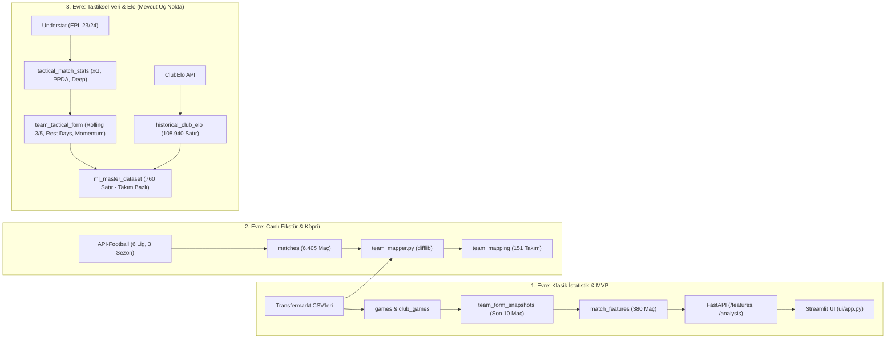
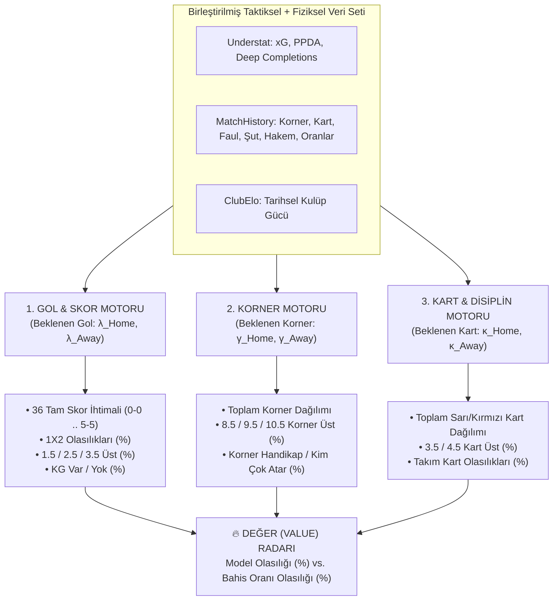
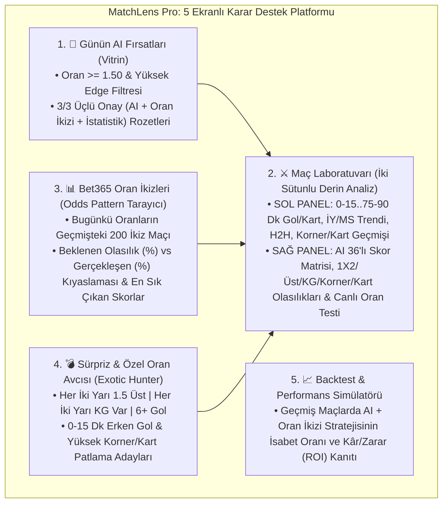

# MatchLens: Baştan Sona Proje Denetimi, Feature Tabloları, Hata Raporu ve "Çoklu Market Olasılık Motoru" Master Planı

Bu doküman, **MatchLens** projesinin ilk satırından bugünkü durumuna kadar ne yapıldığını, neden yapıldığını, veritabanındaki **16 tablonun** ve tüm **Feature setlerinin** tam şemalarını, tespit edilen **tüm hata/eksik/fazlalıkları** ve projenin ulaşabileceği **Top Nokta (Çoklu Market Olasılık, Korner/Kart ve Oran/Value Motoru)** mimarisini eksiksiz olarak kayıt altına alır.

---

# 🏛️ BÖLÜM 1: Projenin Kronolojik Hikayesi (Ne Yaptık, Neden Yaptık, Nereye Kadar Geldik?)

Proje, hazır şablonlar kullanmak yerine her problemi bizzat deneyimleyerek ("hard-code" yazarak) veri mühendisliği, backend mimarisi ve makine öğrenmesi (ML) sistem tasarımını öğrenmek amacıyla **3 büyük evreden (kuşaktan)** geçti:



### 1. Evre: "Saf Python'dan Pandas ve SQL'e Geçiş" & İlk Uçtan Uca MVP
1. **Saf Python ile İlk Deneme (`archive/explore_player_scores.py`):**
   - **Ne yapıldı?** Hiç veritabanı veya Pandas kullanmadan, Python'un yerleşik `csv.DictReader` modülüyle `games.csv`, `clubs.csv` ve `club_games.csv` dosyaları satır satır okunup `for` döngüleriyle 2012 Premier League (`GB1`) takımlarının son 10 maçlık form tablosu çıkarıldı.
   - **Neden yapıldı?** Algoritmik düşünmeyi ve ham verinin yapısını (`game_id`, `club_id`, `own_goals`, `opponent_goals`) anlamak için.
   - **Neyi öğretti?** CSV dosyalarını her seferinde `for` döngüsüyle taramak çok yavaştı ve sadece sezon sonundaki durumu veriyordu; oysa modele **her maçın oynandığı tarihteki** geçmiş form lazımdı.

2. **Data Leakage (Veri Sızıntısı) Kavramıyla Tanışma (`archive/form_engine_pandas.py`):**
   - **Ne yapıldı?** `get_team_form_stats` fonksiyonu yazıldı ve içine şu kritik filtre eklendi:
     ```python
     target_team_games = target_team_games[target_team_games['date'] < current_date]
     ```
   - **Neden yapıldı?** 10 Kasım 2012'deki bir maçı tahmin edeceksek, modelin 11 Kasım veya Aralık ayındaki maçları bilmemesi gerekir. Sadece `date < current_date` olan maçlar filtrelenip tarihe göre tersten sıralanarak `.head(10)` alındı ve **Data Leakage** (gelecek bilgisinin geçmişe sızması) problemi çözüldü.

3. **SQLite Veritabanına Geçiş ve Uçtan Uca MVP (`archive/db_builder.py` & `archive/form_engine_sql.py`):**
   - **Ne yapıldı?** CSV'ler `database/matchlens.db` içine aktarıldı. `team_form_snapshots` tablosu oluşturulup SQL `JOIN` sorgusuyla her maçın Ev Sahibi (`home_form`) ve Deplasman (`away_form`) istatistikleri yan yana getirilerek `match_features` tablosu üretildi.
   - **Üzerine ne kuruldu?** Bu tabloyu dış dünyaya açmak için **FastAPI** (`api/main.py`), maçları yorumlamak için **Kural Tabanlı Analiz Motoru** (`api/services/analysis_engine.py`) ve görselleştirmek için **Streamlit Karar Destek Paneli** (`ui/app.py`) yazıldı.

---

### 2. Evre: "Gerçek Dünya ile Bağlantı" (API-Football & Takım Eşleştirme)
1. **Canlı / Güncel Fikstür Çekimi (`data_pipeline/ingest_api.py` & `data_pipeline/db_manager.py`):**
   - **Ne yapıldı?** Kaggle'daki Transfermarkt verisi statik olduğu için `v3.football.api-sports.io` servisine bağlanılıp 6 büyük ligin (Premier League `39`, La Liga `140`, Serie A `135`, Bundesliga `78`, Ligue 1 `61`, Süper Lig `203`) 2022, 2023 ve 2024 sezonlarındaki **6.405 maçı** `matches` tablosuna kaydedildi.
2. **İki Farklı Dünyayı Konuşturma — Entity Resolution (`data_pipeline/team_mapper.py` & `data_pipeline/save_mapping.py`):**
   - **Neden yapıldı?** API-Football'da `"Wolves"` (ID: `39`) olarak geçen takım, Transfermarkt'ta `"Wolverhampton Wanderers"` (ID: `543`); `"Brighton"` (ID: `51`) ise `"Brighton & Hove Albion"` (ID: `1237`) olarak geçiyordu.
   - **Nasıl çözüldü?** Python'un `difflib.get_close_matches(..., cutoff=0.6)` algoritmasıyla otomatik bir taslak (`team_mapping_draft.csv`) üretildi, bulamadıkları elle düzeltildi ve `save_mapping.py` ile veritabanına `team_mapping` (151 takım) köprü tablosu olarak gömüldü. Ayrıca `archive/feature_builder.py` içinde `pd.merge_asof(..., direction='backward')` kullanılarak API maçlarına en yakın geçmiş Transfermarkt formunu bağlama denemesi yapıldı.

---

### 3. Evre: "Klasik İstatistik Yetmez, Taktiksel Derinlik Lazım!" (Understat + ClubElo)
*"Bir takımın son maçını 1-0 kazanması gerçekten iyi oynadığını mı gösterir, yoksa şans eseri mi kazandı?"* sorusuna yanıt aranan evre:
1. **Understat Taktiksel Veri Çekimi (`data_pipeline/ingest_understat.py`):**
   - `soccerdata` kütüphanesiyle Premier League 2023/2024 sezonunun 380 maçı için sadece goller değil; **xG (Gol Beklentisi)**, **np_xG (Penaltısız xG)**, **PPDA (Pres Şiddeti)** ve **Deep Completions (Ceza sahası çevresi başarılı pas)** verileri çekilip `tactical_match_stats` tablosuna yazıldı.
2. **Taktiksel Feature Engineering (`data_pipeline/feature_engine.py`):**
   - `build_tactical_features` fonksiyonunda; maçlar takım bazlı zaman serisine dönüştürülüp, `shift(1)` ile sızıntı önlenerek **Son 3 ve 5 maçlık Rolling Ortalamalar**, **Dinlenme Günleri (`rest_days`)** ve **Taktiksel Momentum (`diff_*`)** değerleri hesaplanıp `team_tactical_form` tablosu üretildi.
3. **Tarihsel Takım Gücü — ClubElo (`data_pipeline/elo_mapper.py` & `data_pipeline/ingest_elo.py`):**
   - *"Son 3 maçında formda olan Luton Town ile son 3 maçında formsuz olan Manchester City aynı güçte midir?"* Hayır! Takımların genel kalite ve kadro ağırlığını modele öğretmek için `soccerdata.ClubElo` üzerinden 20 Premier League takımının 1946'dan 2026'ya kadar **108.940 satırlık** Elo geçmişi `historical_club_elo` tablosuna çekildi.
4. **Kaldığımız Son Nokta (`data_pipeline/merge_features.py`):**
   - `team_tactical_form` tablosundaki her takımın maç tarihi (`date`), `historical_club_elo` tablosundaki `from <= date <= to` tarih aralığıyla eşleştirilip **`ml_master_dataset`** tablosu oluşturuldu.

> [!IMPORTANT]
> **Kritik Mimari Tespit:** Şu anda projede **1. Evre** (`match_features` -> FastAPI -> Streamlit UI) ile **3. Evre** (`tactical_match_stats` -> `ml_master_dataset`) henüz birbirine bağlanmamış durumda. FastAPI ve Streamlit hâlâ 2012/2013 sezonunun klasik `match_features` tablosunu okuyor; yeni üretilen taktiksel + Elo veri seti ise `ml_master_dataset` içinde modeli ve API'yi bekliyor.

---

# 🗄️ BÖLÜM 2: Veritabanındaki 16 Tablonun Tam Envanteri (`database/matchlens.db`)

`database/matchlens.db` içerisinde yer alan **16 tablonun** görevlerine göre tam dökümü:

### Grup 1: 3. Evre (Yeni Taktiksel + Elo + ML Hattı) Tabloları
| # | Tablo Adı | Satır | Sütun | Kapsam | Üreten Dosya | Ne İşe Yarıyor? |
| :--- | :--- | ---: | ---: | :--- | :--- | :--- |
| 1 | **`tactical_match_stats`** | 380 | 29 | EPL 2023/24 | `ingest_understat.py` | Understat'tan çekilen maçların ham taktiksel istatistikleri (`home_xg`, `away_xg`, `home_ppda`, `away_deep_completions` vb.). |
| 2 | **`team_tactical_form`** | 760 | 21 | EPL 2023/24 | `feature_engine.py` | 380 maçın 20 takım için alt alta (`20 × 38 = 760`) dizilip Rolling 3/5, `rest_days` ve `diff_*` momentum feature'larının hesaplandığı ara tablo. |
| 3 | **`historical_club_elo`** | 108.940 | 8 | 1946–2026 (20 Takım) | `ingest_elo.py` | 20 Premier League takımının tüm Elo puanı değişim aralıkları (`from`, `to`, `elo`, `rank`, `original_team_name`). |
| 4 | **`ml_master_dataset`** | 760 | 22 | EPL 2023/24 | `merge_features.py` | `team_tactical_form` tablosuna her takımın o maç günkü `elo` puanının eklendiği **en güncel takım bazlı feature tablosu**. |

### Grup 2: 1. Evre (Klasik İstatistik + Şu Anki API/UI Hattı) Tabloları
| # | Tablo Adı | Satır | Sütun | Kapsam | Üreten Dosya | Ne İşe Yarıyor? |
| :--- | :--- | ---: | ---: | :--- | :--- | :--- |
| 5 | **`games`** | 88.958 | 23 | 2006–2026 | `db_builder.py` | Transfermarkt'tan gelen tüm tarihsel maçlar. |
| 6 | **`club_games`** | 177.916 | 11 | 2006–2026 | `db_builder.py` | `games` tablosundaki her maçın Ev ve Deplasman takımı için 2 satır (`88.958 × 2`) olarak kırılmış hali (`own_goals`, `opponent_goals`, `is_win`). |
| 7 | **`competitions`** | 65 | 11 | Tüm Ligler | `db_builder.py` | Transfermarkt lig ve kupa referans tablosu (`GB1`, `TR1`, `ES1` vb.). |
| 8 | **`tm_clubs`** | 796 | 17 | Kulüpler | `ingest_historical.py` | Transfermarkt kulüp bilgileri (`club_id`, `name`, `squad_size`, `average_age`, `total_market_value`). |
| 9 | **`team_form_snapshots`** | 760 | 16 | EPL 2012/13 | `form_engine_sql.py` | 2012/13 Premier League (`GB1`) sezonu için her takımın maç öncesi son 10 maçlık klasik form özeti. **FastAPI `/teams/{club_id}/form` burayı okur.** |
| 10 | **`match_features`** | 380 | 17 | EPL 2012/13 | `form_engine_sql.py` | 2012/13 Premier League maçlarının Ev ve Deplasman form farklarını (`form_advantage`, `btts_tendency`, `over_2_5_tendency`) ve ML hedeflerini (`target_btts`, `target_over_2_5`) tutan tablo. **FastAPI `/features` ve `/matches/{id}/analysis` burayı okur.** |

### Grup 3: 2. Evre (Canlı Fikstür & Köprü) Tabloları
| # | Tablo Adı | Satır | Sütun | Kapsam | Üreten Dosya | Ne İşe Yarıyor? |
| :--- | :--- | ---: | ---: | :--- | :--- | :--- |
| 11 | **`matches`** | 6.405 | 12 | 6 Lig, 2022–2024 | `ingest_api.py` | API-Football'dan çekilen 6 majör ligin 2022, 2023 ve 2024 sezonlarındaki tüm maçları (`match_id`, `league_id`, `home_team_id`, `away_team_id`, `home_goals`, `away_goals`). |
| 12 | **`team_mapping`** | 151 | 4 | 6 Majör Lig | `save_mapping.py` | API-Football takım ID/isimlerini (`api_id`, `api_name`) Transfermarkt kulüp ID/isimlerine (`tm_id`, `tm_name`) bağlayan köprü tablosu. |

### Grup 4: Mükerrer (Kopya) ve Atıl Tablolar *(Fazlalıklar)*
| # | Tablo Adı | Satır | Sütun | Üreten Dosya | Neden Fazlalık? |
| :--- | :--- | ---: | ---: | :--- | :--- |
| 13 | **`tm_games`** | 88.958 | 23 | `ingest_historical.py` | `games` tablosunun %100 birebir kopyası (`games.csv` farklı tablo adıyla tekrar yazılmış). |
| 14 | **`tm_team_form`** | 760 | 16 | `ingest_historical.py` | `team_form_snapshots` tablosunun %100 birebir kopyası (`team_form_snapshot.csv` dosyasından tekrar yüklenmiş). |
| 15 | **`tm_players`** | 50.149 | 26 | `ingest_historical.py` | Transfermarkt oyuncu listesi. Projede şu an hiçbir kod veya sorgu bu tabloyu kullanmıyor. |
| 16 | **`tm_player_valuations`** | 507.815 | 6 | `ingest_historical.py` | Oyuncuların tarihsel piyasa değerleri. Yarım milyon satırla veritabanını şişiriyor ama şu an kullanılmıyor. |

---

# 🧬 BÖLÜM 3: Tüm Feature Tablolarının ve Sütunlarının Detaylı Analizi

Projede üretilen feature tabloları **Yeni Kuşak (Taktiksel + Elo)** ve **Eski Kuşak (Klasik Form)** olmak üzere ikiye ayrılır:

## 3.1. Yeni Kuşak Feature Tablosu: `ml_master_dataset` (760 Satır, 22 Sütun)
`data_pipeline/feature_engine.py` ve `data_pipeline/merge_features.py` tarafından üretilmiştir. Her satır **1 takımın 1 maçını** temsil eder (`20 takım × 38 maç = 760 satır`).

### Veritabanından Gerçek Örnek (Arsenal'in 2023/24 Sezonundaki İlk 4 Maçı):
| `date` | `team` | `xg_for` *(O maç)* | `ppda` *(O maç)* | `rolling_3_xg_for` | `rolling_3_ppda` | `rest_days` | `prev_xg_for` | `diff_xg_rolling_3` | `elo` |
| :--- | :--- | ---: | ---: | ---: | ---: | ---: | ---: | ---: | ---: |
| `2023-08-12` | Arsenal | 0.8426 | 4.0000 | `NaN` | `NaN` | 7.0 | `NaN` | `NaN` | 1919.38 |
| `2023-08-21` | Arsenal | 2.2059 | 9.6000 | 0.8426 | 4.0000 | 9.0 | 0.8426 | 0.0000 | 1921.48 |
| `2023-08-26` | Arsenal | 3.2309 | 8.0000 | 1.5243 | 6.8000 | 4.0 | 2.2059 | +0.6817 | 1927.04 |
| `2023-09-03` | Arsenal | 1.9097 | 19.4375 | 2.0931 | 7.2000 | 8.0 | 3.2309 | +1.1377 | 1921.01 |

*(26 Ağustos maçına çıkarken `rolling_3_xg_for` değeri `(0.8426 + 2.2059) / 2 = 1.5243` olarak hesaplanmıştır; yani 26 Ağustos'ta üretilen `3.2309` xG ortalamaya dahil edilmemiştir. `.shift(1)` tam olarak bu sızıntıyı önler.)*

### `ml_master_dataset` İçindeki 22 Sütunun Tam Şeması ve Formülleri:

| # | Sütun Adı | Veri Tipi | Kategori | Matematiksel Formül / Açıklama | Sızıntı (Leakage) Durumu |
| :--- | :--- | :--- | :--- | :--- | :--- |
| 1 | `date` | `TIMESTAMP` | Kimlik | Maç tarihi (`.dt.normalize()` ile saati sıfırlanmış) | Güvenli |
| 2 | `team` | `TEXT` | Kimlik | Understat takım adı (`Arsenal`, `Manchester City` vb.) | Güvenli |
| 3 | `xg_for` | `REAL` | **Ham Maç İçi** | Takımın **o maçta** ürettiği gol beklentisi (xG) | ❌ **Sızıntı! Modele X olarak verilmemeli** |
| 4 | `xg_against` | `REAL` | **Ham Maç İçi** | Takımın **o maçta** kalesinde gördüğü gol beklentisi (xGA) | ❌ **Sızıntı! Modele X olarak verilmemeli** |
| 5 | `ppda` | `REAL` | **Ham Maç İçi** | **O maçtaki** pres şiddeti (Passes Allowed Per Defensive Action). Düşük sayı = Yoğun önde pres; Yüksek sayı = Derin savunma. | ❌ **Sızıntı! Modele X olarak verilmemeli** |
| 6 | `deep_completions` | `INTEGER` | **Ham Maç İçi** | **O maçtaki** rakip kaleye 20m mesafeye yapılan başarılı pas sayısı (3. bölge dominasyonu) | ❌ **Sızıntı! Modele X olarak verilmemeli** |
| 7 | `rolling_3_xg_for` | `REAL` | Kısa Vadeli Form | `xg_for.rolling(3, min_periods=1).mean().shift(1)` (Son 3 maç ortalama xG) | ✅ Güvenli (`shift(1)`) |
| 8 | `rolling_3_xg_against` | `REAL` | Kısa Vadeli Form | `xg_against.rolling(3, min_periods=1).mean().shift(1)` (Son 3 maç ortalama yenilen xG) | ✅ Güvenli (`shift(1)`) |
| 9 | `rolling_3_ppda` | `REAL` | Kısa Vadeli Form | `ppda.rolling(3, min_periods=1).mean().shift(1)` (Son 3 maç ortalama pres şiddeti) | ✅ Güvenli (`shift(1)`) |
| 10 | `rolling_3_deep_completions` | `REAL` | Kısa Vadeli Form | `deep_completions.rolling(3, min_periods=1).mean().shift(1)` (Son 3 maç ortalama 3. bölge pası) | ✅ Güvenli (`shift(1)`) |
| 11 | `rolling_5_xg_for` | `REAL` | Orta Vadeli Form | `xg_for.rolling(5, min_periods=1).mean().shift(1)` (Son 5 maç ortalama xG) | ✅ Güvenli (`shift(1)`) |
| 12 | `rolling_5_xg_against` | `REAL` | Orta Vadeli Form | `xg_against.rolling(5, min_periods=1).mean().shift(1)` (Son 5 maç ortalama yenilen xG) | ✅ Güvenli (`shift(1)`) |
| 13 | `rolling_5_ppda` | `REAL` | Orta Vadeli Form | `ppda.rolling(5, min_periods=1).mean().shift(1)` (Son 5 maç ortalama pres şiddeti) | ✅ Güvenli (`shift(1)`) |
| 14 | `rolling_5_deep_completions` | `REAL` | Orta Vadeli Form | `deep_completions.rolling(5, min_periods=1).mean().shift(1)` (Son 5 maç ortalama 3. bölge pası) | ✅ Güvenli (`shift(1)`) |
| 15 | `rest_days` | `REAL` | Fiziksel / Fikstür | `date.diff().dt.days.fillna(7)` (Bir önceki maçtan bu yana dinlenilen gün sayısı) | ✅ Güvenli |
| 16 | `prev_xg_for` | `REAL` | Son Maç Sinyali | `xg_for.shift(1)` (Bir önceki maçta üretilen xG) | ✅ Güvenli (`shift(1)`) |
| 17 | `prev_ppda` | `REAL` | Son Maç Sinyali | `ppda.shift(1)` (Bir önceki maçtaki PPDA) | ✅ Güvenli (`shift(1)`) |
| 18 | `prev_deep` | `REAL` | Son Maç Sinyali | `deep_completions.shift(1)` (Bir önceki maçtaki Deep Completions) | ✅ Güvenli (`shift(1)`) |
| 19 | `diff_xg_rolling_3` | `REAL` | Momentum (İvme) | `prev_xg_for - rolling_3_xg_for` (Pozitifse takım son maçta formunun üstüne çıkmış/ivmelenmiştir) | ✅ Güvenli |
| 20 | `diff_ppda_rolling_3` | `REAL` | Momentum (İvme) | `prev_ppda - rolling_3_ppda` (Son maçtaki pres değişimi) | ✅ Güvenli |
| 21 | `diff_deep_rolling_3` | `REAL` | Momentum (İvme) | `prev_deep - rolling_3_deep_completions` (Son maçtaki 3. bölge pas ivmesi) | ✅ Güvenli |
| 22 | `elo` | `REAL` | Tarihsel Güç | Maç gününde (`from <= date <= to`) takımın ClubElo puanı | ✅ Güvenli |

---

## 3.2. Eski Kuşak Feature Tabloları: `team_form_snapshots` & `match_features`
Şu an çalışan FastAPI ve Streamlit arayüzünün beslendiği, 2012/2013 Premier League (`GB1`) sezonuna ait tablolardır:

### A. `team_form_snapshots` Şeması (760 Satır, 16 Sütun — Takım Bazlı)
| # | Sütun Adı | Veri Tipi | Formül / Açıklama |
| :--- | :--- | :--- | :--- |
| 1 | `club_id` | `INTEGER` | Transfermarkt kulüp ID'si |
| 2 | `matches_played` | `INTEGER` | Maç tarihinden önce oynanan maç sayısı (`0` – `10` arası) |
| 3 | `wins` | `INTEGER` | Son 10 maçtaki galibiyet sayısı (`own_goals > opponent_goals`) |
| 4 | `draws` | `INTEGER` | Son 10 maçtaki beraberlik sayısı (`own_goals == opponent_goals`) |
| 5 | `loses` | `INTEGER` | Son 10 maçtaki mağlubiyet sayısı (`own_goals < opponent_goals`) |
| 6 | `last_10_games_own_goals` | `INTEGER` | Son 10 maçta atılan toplam gol |
| 7 | `last_10_games_opp_goals` | `INTEGER` | Son 10 maçta yenilen toplam gol |
| 8 | `total_games_over_2_5` | `INTEGER` | Son 10 maçta `(own_goals + opponent_goals) > 2.5` olan maç sayısı |
| 9 | `total_games_btts` | `INTEGER` | Son 10 maçta `(own_goals > 0) & (opponent_goals > 0)` olan maç sayısı |
| 10 | `avg_goal_per_game` | `REAL` | `(last_10_games_own_goals + last_10_games_opp_goals) / matches_played` |
| 11 | `btts_rate` | `REAL` | `total_games_btts / matches_played` (`0.0` – `1.0` arası KG Var oranı) |
| 12 | `total_over_2_5` | `REAL` | `total_games_over_2_5 / matches_played` (`0.0` – `1.0` arası 2.5 Üst oranı) |
| 13 | `points` | `INTEGER` | `(wins * 3) + (draws * 1)` (Son 10 maçta toplanan toplam puan) |
| 14 | `average_point_per_game` | `REAL` | `points / matches_played` (Maç başı puan - PPG) |
| 15 | `date` | `TIMESTAMP` | Maç tarihi |
| 16 | `game_id` | `INTEGER` | Maç ID'si |

### B. `match_features` Şeması (380 Satır, 17 Sütun — Maç Bazlı)
| # | Sütun Adı | Veri Tipi | Kategori | Formül / Açıklama |
| :--- | :--- | :--- | :--- | :--- |
| 1 | `game_id` | `INTEGER` | Kimlik | Transfermarkt Maç ID'si |
| 2 | `date` | `TEXT` | Kimlik | Maç tarihi |
| 3 | `home_club_id` | `INTEGER` | Kimlik | Ev sahibi kulüp ID'si |
| 4 | `away_club_id` | `INTEGER` | Kimlik | Deplasman kulüp ID'si |
| 5 | `home_club_goals` | `INTEGER` | Gerçek Sonuç | Ev sahibinin maçta attığı gol |
| 6 | `away_club_goals` | `INTEGER` | Gerçek Sonuç | Deplasmanın maçta attığı gol |
| 7 | `home_points` | `INTEGER` | Ham Feature | Ev sahibinin son 10 maç puanı |
| 8 | `home_btts_rate` | `REAL` | Ham Feature | Ev sahibinin son 10 maç KG Var oranı |
| 9 | `away_btts_rate` | `REAL` | Ham Feature | Deplasmanın son 10 maç KG Var oranı |
| 10 | `away_points` | `INTEGER` | Ham Feature | Deplasmanın son 10 maç puanı |
| 11 | `home_over_2_5_rate` | `REAL` | Ham Feature | Ev sahibinin son 10 maç 2.5 Üst oranı |
| 12 | `away_over_2_5_rate` | `REAL` | Ham Feature | Deplasmanın son 10 maç 2.5 Üst oranı |
| 13 | **`form_advantage`** | `INTEGER` | **Türetilmiş Feature** | `home_points - away_points` |
| 14 | **`btts_tendency`** | `REAL` | **Türetilmiş Feature** | `(home_btts_rate + away_btts_rate) / 2` |
| 15 | **`over_2_5_tendency`** | `REAL` | **Türetilmiş Feature** | `(home_over_2_5_rate + away_over_2_5_rate) / 2` |
| 16 | **`target_btts`** | `INTEGER` | **ML Target (Hedef)** | `(home_club_goals > 0) & (away_club_goals > 0)` ise `1`, değilse `0` |
| 17 | **`target_over_2_5`** | `INTEGER` | **ML Target (Hedef)** | `(home_club_goals + away_club_goals) > 2.5` ise `1`, değilse `0` |

---

# 🧠 BÖLÜM 4: Mevcut Kural Tabanlı Modelin Çalışma Mantığı (`api/services/analysis_engine.py`)

Şu an `/matches/{game_id}/analysis` endpoint'i çağrıldığında çalışan `analyze_match` fonksiyonu aşağıdaki deterministik karar ağacını (if-else) işletir:

1. **Ev Sahibi Güç Skoru (`calculate_form_score`):**
   - `form_advantage >= 5` $\rightarrow$ **Skor: 80** (*"Home team has a clear form advantage."*)
   - `form_advantage >= 2` $\rightarrow$ **Skor: 65** (*"Home team is slightly ahead in form."*)
   - `form_advantage <= -5` $\rightarrow$ **Skor: 20** (*"Away team has a massive form advantage."*)
   - `form_advantage <= -2` $\rightarrow$ **Skor: 35** (*"Away team is slightly ahead in form."*)
   - `-2 < form_advantage < 2` $\rightarrow$ **Skor: 50** (*"The teams have equal form."*)

2. **Gol Beklentisi Skoru (`calculate_goals_score`):**
   - `avg_tendency = (btts_tendency + over_2_5_tendency) / 2` hesaplanır:
   - `avg_tendency >= 0.75` $\rightarrow$ **Skor: 85** (*"Statistics indicate a high-scoring match."*)
   - `avg_tendency >= 0.60` $\rightarrow$ **Skor: 70** (*"Above average goal potential."*)
   - `avg_tendency <= 0.25` $\rightarrow$ **Skor: 15** (*"Statistics point to a low-scoring defensive match."*)
   - `avg_tendency <= 0.40` $\rightarrow$ **Skor: 30** (*"Below average goal potential."*)
   - Arada ise $\rightarrow$ **Skor: 50** (*"Unclear goal potential, unpredictable match."*)

---

# 🔍 BÖLÜM 5: Tespit Edilen Tüm Kod Hataları (Bugs), Eksikler ve Fazlalıklar

### 🚨 1. Kod Hataları (Bugs)
1. **`data_pipeline/run_pipeline.py` (Satır 4 & 15-20):**
   - Satır 4'te `os.path.abspath(__line__)` yazılmış. Python'da `__line__` diye yerleşik bir değişken yoktur, doğrusu `__file__` olmalıdır. Çalıştırıldığı anda `NameError` verir.
   - İçinde çağrılan `ingest_historical.run()`, `ingest_api.run()`, `team_mapper.run()` fonksiyonları o dosyalarda tanımlı değildir. Ayrıca yeni yazılan `ingest_understat.py`, `ingest_elo.py` ve `merge_features.py` bu pipeline dosyasına eklenmemiştir.
2. **`data_pipeline/ingest_api.py` (Satır 1–148):**
   - 1. ile 74. satır arasındaki tüm kod bloğu, 75. ile 148. satır arasında yanlışlıkla ikinci kez kopyalanıp yapıştırılmıştır (Duplicate Code).
3. **`api/services/analysis_engine.py` (Satır 1–81):**
   - Dosyada **iki adet `def analyze_match(match_data: dict)`** fonksiyonu vardır! İlk fonksiyon (Satır 1–15, Türkçe yorum ve `form_advantage_score` döndüren) alttaki ikinci fonksiyon (Satır 63–81, İngilizce `reasons` ve `home_strength_score` döndüren) tarafından ezilmektedir (shadowing).
   - `api/main.py` içinde Satır 62'de `adv_score = match_data["form_advantage"]` değişkeni tanımlanmış ama hiçbir yerde kullanılmamıştır.
4. **`ui/app.py` ile FastAPI Arasındaki Veri Kopuklukları ve Yazım Hataları:**
   - **Genel Bakış Sayfası (`page_overview`):** `/features` endpoint'inden dönen `match_features` tablosunda `analysis`, `home_club_name`, `away_club_name`, `league` sütunları **yoktur** (sadece `home_club_id`, `away_club_id` vardır). Bu yüzden Genel Bakış'ta *"Analiz Hazır"* kartı **0**, *"Riskli / Denk"* kartı **0** görünmekte, skorboard'da takım adları yerine `"Ev Sahibi #289"` yazmakta ve sağdaki *"Risk"* sekmesi *"Analiz özeti kolonu bulunamadı"* uyarısı vermektedir.
   - **Form Sinyali Eşiği Hatası (Satır 457):** `numeric_form.abs() >= 0.4` kontrolü yapılmıştır. Oysa `form_advantage` puan farkı olduğu için tam sayıdır (`-30` ile `+30` arası). Yani puan farkı `0` olmayan her maç (`1`, `-1` dahil) "Güçlü Form Sinyali" sayılmaktadır.
   - **Karakter Bozuklukları:** Satır 375'te `·` bozuk UTF-8 karakteri; Satır 444, 634, 670, 672'de kelime ortasında büyük `Ş` (`eŞleŞen`, `Maç BaŞı Puan`, `baŞarılı`, `baŞarısız`) yazım hataları mevcuttur.
5. **`data_pipeline/feature_engine.py` (Satır 53–75):**
   - `build_team_form_snapshots` fonksiyonunda `WHERE competition_id = 'GB1' AND season = 2012` filtresi kaldırılmıştır; çalıştırılırsa `club_games` içindeki 177.916 satırın tamamında `iterrows()` döngüsüne girip ($O(N^2)$ karmaşıklık) saatlerce kilitlenir.

### 🧩 2. Mimari Eksikler
1. **`ml_master_dataset` Henüz Maç Bazlı (Ev Sahibi vs. Deplasman) Değil:**
   - Şu an 760 satırlık takım bazlı formatta duruyor. `tactical_match_stats` üzerinden Ev Sahibi (`home_`) ve Deplasman (`away_`) olarak tek satırda (380 satır) birleştirilmesi, maç içi sızıntı sütunlarının (`xg_for`, `ppda` vb.) eğitim girdilerinden düşürülmesi ve hedef değişkenlerin (`target_*`) eklenmesi gerekiyor.
2. **İlk Hafta `NaN` Değerleri (20 Satır):**
   - Her takımın sezondaki 1. hafta maçında geçmiş maç olmadığı için rolling ortalamaları `NaN` durumdadır.
3. **Veri Ölçeği:**
   - Taktiksel veriler şu an sadece 1 lig ve 1 sezon (EPL 2023/24 - 380 maç) için çekilmiştir.

### 🧹 3. Fazlalıklar ve Çöp Dosyalar
- **Veritabanında:** `tm_games` (88.958 satır kopya), `tm_team_form` (760 satır kopya), `tm_players` (50.149 satır atıl), `tm_player_valuations` (507.815 satır atıl).
- **Dosya Sisteminde:** Root dizinindeki `/.swp` dosyası ve `/__pycache__/` klasörü, `/data/cd/` boş klasörü, `/downloaded_files/*.lock` kilit dosyaları, `data_pipeline/csv_data.py` tek kullanımlık deneme dosyası.
- **Dokümantasyonda:** `docs/02_current_state.md` ve `docs/05_project_structure.md` içinde eski dosya isimleri (`streamlit_app.py`, `import_csv.py`, `api_client.py`, `scripts/`) kalmıştır.

---

# 🚀 BÖLÜM 6: Projenin Top Noktası — 5 Seviyeli Gelişim Planı (Improvement Plan)

Projeyi sıradan bir öğrenci projesinden çıkarıp profesyonel kulüp analistlerinin ve kantitatif modellerin kullandığı seviyeye taşıyacak 5 basamaklı mimari plan:

### 🥉 SEVİYE 1: Sağlam Veri Mühendisliği & Taktiksel Çarpışma Feature'ları
1. **Çoklu Lig ve Çoklu Sezon Ölçeklemesi (~7.500+ Maç):**
   - 380 maçtaki ezberleme (*overfitting*) riskini aşmak için 5 Büyük Lig × Son 4-5 Sezon verisine çıkılması.
2. **Klinik Bitiricilik / Şans Faktörü (`xG Overperformance / Regression to the Mean`):**
   - $\text{Finishing\_Luck} = \text{Rolling\_5\_Goals} - \text{Rolling\_5\_xG}$. Son 5 maçta `4.0 xG` üretip `10 gol` atan takımın "sürdürülemez şansını" (ortalamaya dönüş sinyalini) ve `10.0 xG` üretip `3 gol` atan takımın patlama potansiyelini yakalamak.
3. **Taktiksel Stil Çarpışması (Interaction Features):**
   - **Pres vs. Oyun Kurma (`Press_vs_BuildUp`):** Ev sahibinin pres şiddeti (`home_rolling_5_ppda`) ile deplasmanın 3. bölgeye pasla girme başarısının (`away_rolling_5_deep`) çarpışması.
   - **Hücum vs. Savunma Zaafı (`Attack_vs_Fragility`):** `home_rolling_5_xg_for * away_rolling_5_xg_against`.
4. **İç Saha / Dış Saha Ayrımı (Venue-Specific Form):**
   - Takımın sadece genel son 5 maçı değil; ev sahibinin iç saha formu ile deplasmanın dış saha formunun ayrı ayrı izlenmesi.

### 🥈 SEVİYE 2: Hibrit Yapay Zeka Mimarisi (Poisson + Gradient Boosting + Kalibrasyon)
1. **1. Katman — Beklenen Gol Regresyonu & Dixon-Coles / Poisson Matrisi:**
   - Doğrudan `1-0-2` sınıflandırması yapmak yerine önce maçtaki **Ev Sahibi Beklenen Gol ($\lambda_{\text{home}}$)** ve **Deplasman Beklenen Gol ($\lambda_{\text{away}}$)** hızlarını tahmin etmek ve buradan 6×6 (36 olası skor) olasılık matrisini çıkarmak.
2. **2. Katman — LightGBM / XGBoost & Olasılık Kalibrasyonu (`Probability Calibration`):**
   - `CalibratedClassifierCV` (Isotonic / Platt Scaling) ile modelin verdiği yüzdeleri gerçek dünya frekanslarına kalibre etmek (**Brier Score** ve **Log-Loss** optimizasyonu).

### 🥇 SEVİYE 3: "Taktiksel DNA" Kümeleme (Unsupervised ML) & Kadro Değeri
1. **K-Means / GMM ile Takım Kimliği Kümeleme:**
   - Takımları `xG`, `PPDA`, `Deep Completions` metriklerine göre otomatik olarak *"Yüksek Pres & Dominant"*, *"Kontrollü Geçiş"*, *"Derin Blok / Otobüs"* olarak kümeleyip hangi oyun stilinin hangisine ters geldiğini modele öğretmek.
2. **Ekonomik Güç Çarpanı:**
   - `tm_clubs` tablosundaki kadro piyasa değerlerini ($\log(\text{Home Value} / \text{Away Value})$) Elo puanının yanına eklemek.

### 💎 SEVİYE 4: Açıklanabilir Yapay Zeka (SHAP) & Pro Koç Paneli
1. **SHAP (SHapley Additive exPlanations):**
   - Her maç tahmini için hangi özelliğin olasılığı yüzde kaç artırdığını/azalttığını şeffafça hesaplamak (*"Baz %45 -> Elo Farkı +%11 -> Pres Üstünlüğü +%7 -> Yorgunluk -%3 = %60"*).
2. **Görsel Koç Paneli:**
   - Plotly ile 6 eksenli **Taktiksel Radar (Örümcek) Grafiği**, **6×6 Skor Olasılık Isı Haritası (Heatmap)** ve SHAP tabanlı otomatik maç senaryosu metni.

### 🏆 SEVİYE 5 (TOP NOKTA): Backtesting Simülatörü & Value Finder
1. **Walk-Forward Backtesting Laboratuvarı:**
   - Modelin geçmiş yüzlerce maçta verdiği olasılıkların gerçek oranlar karşısındaki **Hit Rate (İsabet Oranı)**, **ROI (Yatırım Getirisi)** ve **Calibration Curve (Güvenilirlik Eğrisi)** simülasyonunu Streamlit'te canlı çizdirmek.

---

# 🎯 BÖLÜM 7: Nihai Vizyon — "Çoklu Market Olasılık (Skor, Korner, Kart) ve Oran/Value Motoru"

Projenin asıl hedefi; bir maçın **tam skor dağılımından kornerine ve kartına kadar tüm olasılıklarını** çıkaran ve bunları **güncel bahis oranlarıyla** birleştirerek matematiksel değer (**Expected Value / Edge**) yakalayan bir motor tasarlamaktır.

## 7.1. Veri Çekme Kâbusunun Kesin Çözümü ("Altın Üçgen" Veri Mimarisi)

FBref veya WhoScored gibi kaynaklar Cloudflare koruması ve tarayıcı otomasyonu (Selenium/ChromeDriver) gerektirdiği için veri çekmek işkenceye dönüşür (`downloaded_files/driver_fixing.lock` hatasının sebebi budur).

Ancak projede zaten kurulu olan `soccerdata` kütüphanesinin içinde **hiç tarayıcı açmayan, Cloudflare'e takılmayan ve tüm sezonu tek istekte saniyeler içinde indiren 3 modül** vardır:

1. **1. Köşe — `soccerdata.MatchHistory` (`football-data.co.uk`):**
   - `.venv/lib/python3.14/site-packages/soccerdata/match_history.py` içinde hazır bulunan bu modül, `football-data.co.uk` üzerindeki sezonluk CSV dosyalarını doğrudan indirir (1 sezonun inmesi **0.5 saniye** sürer, API key veya limit yoktur).
   - **İçerdiği Kritik Sütunlar:**
     - **Kornerler:** `HC` (Ev Sahibi Korner), `AC` (Deplasman Korner)
     - **Kartlar:** `HY` / `AY` (Sarı Kartlar), `HR` / `AR` (Kırmızı Kartlar)
     - **Fauller:** `HF` / `AF` (Ev ve Deplasman Faul Sayıları)
     - **Şutlar:** `HS` / `AS` (Toplam Şut), `HST` / `AST` (İsabetli Şut)
     - **Hakem:** `Referee` (Maçın hakemi — *Kart modeli için en belirleyici faktör!*)
     - **İlk Yarı / Maç Sonu Golleri:** `HTHG`, `HTAG`, `FTHG`, `FTAG`
     - **Gerçek Bahis Oranları (Bookmaker Odds):** `B365H`, `B365D`, `B365A` (Bet365), `PSH`, `PSD`, `PSA` (Pinnacle), `AvgH`, `AvgD`, `AvgA` (Piyasa Ortalaması), `B365>2.5`, `B365<2.5` (Alt/Üst oranları).
2. **2. Köşe — `soccerdata.Understat`:**
   - 5 Büyük Lig (`ENG-Premier League`, `ESP-La Liga`, `ITA-Serie A`, `GER-Bundesliga`, `FRA-Ligue 1`) için sezon başına tek bir JSON isteğiyle `xG`, `np_xG`, `PPDA` ve `Deep Completions` verilerini 1-2 dakikada indirir.
3. **3. Köşe — `soccerdata.ClubElo`:**
   - Takımların tarihsel güç puanlarını (`elo`) sağlar.

> [!TIP]
> **Kusursuz Birleşme:** Hem `sd.Understat` hem de `sd.MatchHistory` aynı `soccerdata` takım ismi standartlaştırma sözlüğünü (`TEAMNAME_REPLACEMENTS`) kullanır. Dolayısıyla Understat'ın taktiksel verileri (`xG`, `PPDA`, `Deep`) ile MatchHistory'nin fiziksel/market verileri (`Korner`, `Kart`, `Faul`, `Şut`, `Hakem`, `Oranlar`) doğrudan `(league, date, home_team, away_team)` üzerinden birleşir!

---

## 7.2. Üçlü Olasılık Motorunun Matematiksel Tasarımı

Her alt market için birbirinden kopuk sınıflandırıcılar kurmak yerine, birbiriyle %100 tutarlı olasılık dağılımları üreten **3 Alt Motor** kurulacaktır:



### 1. Alt Motor: Gol ve Tam Skor Olasılık Motoru ($\lambda_{\text{home\_goals}}, \lambda_{\text{away\_goals}}$)
- **Girdiler (Features):** `rolling_3/5_xg_for`, `rolling_3/5_xg_against`, `finishing_luck (goals - xG)`, `shots_on_target_rolling`, `deep_completions`, `elo_diff`, `rest_days`.
- **Çalışma Prensibi:** LightGBM / XGBoost (`objective="count:poisson"`) modeli her iki takım için beklenen gol parametresini ($\lambda_H, \lambda_A$) üretir.
- **Çıktılar (Bivariate Poisson / Dixon-Coles Matrisi):**
  - `0-0`'dan `5-5`'e kadar **36 tam skorun olasılık yüzdesi**.
  - Matrisin alt küme toplamlarından otomatik ve çelişkisiz olarak: **Maç Sonucu (`1`, `X`, `2`)**, **Alt/Üst (`1.5`, `2.5`, `3.5`)** ve **Karşılıklı Gol (`KG Var / Yok`)** olasılıkları.

### 2. Alt Motor: Korner Olasılık Motoru ($\gamma_{\text{home\_corners}}, \gamma_{\text{away\_corners}}$)
- **Girdiler (Features):**
  - `rolling_5_corners_for` & `rolling_5_corners_against` (Geçmiş korner ortalamaları).
  - `rolling_5_shots` & `rolling_5_deep_completions` (Ceza sahası çevresi pas ve şut baskısı).
  - **Taktiksel Korner Çarpışması (`Dominance_vs_LowBlock`):** Ev sahibinin `deep_completions` değeri yüksek, rakibin ise `ppda` değeri çok yüksekse (rakip kendi ceza sahasına gömülüp şut/orta blokluyorsa) korner beklentisi fırlar.
- **Çıktılar (Poisson / Negative Binomial Dağılımı):**
  - Beklenen korner sayıları ($\gamma_H, \gamma_A$), **Toplam Korner `8.5 Üst %`, `9.5 Üst %`, `10.5 Üst %`** ve **Korner Maç Sonucu / Handikap** olasılıkları.

### 3. Alt Motor: Kart ve Disiplin Motoru ($\kappa_{\text{home\_cards}}, \kappa_{\text{away\_cards}}$)
- **Girdiler (Features):**
  - **Hakem Sertlik İndeksi (`referee_avg_cards` & `referee_cards_per_foul`):** `Referee` sütunundan hakemin geçmiş maçlarında maç başına çıkardığı kart ortalaması ve faul başına kart oranı.
  - **Pres ve Faul Çarpışması (`rolling_5_fouls` & `rolling_5_ppda`):** Agresif önde pres (`ppda` düşük) ve yüksek faul ortalamasına sahip takımların geçiş oyunu çarpışması.
  - **Maç Gerilim İndeksi (`elo_closeness`):** `|home_elo - away_elo|` farkı ne kadar küçükse (denk güçlerin kritik maçıysa) kart beklentisi o kadar yükselir.
- **Çıktılar:**
  - Beklenen kart sayıları ($\kappa_H, \kappa_A$), **`3.5 Kart Üst %`, `4.5 Kart Üst %`** ve **Takım Kart** olasılıkları.

---

## 7.3. Oranlarla Birleştirme ve "Value (Değer) Listesi" Hesaplaması

Modelin ürettiği her olasılık ($P_{\text{model}}$), bahis oranının içerdiği örtük olasılıkla ($P_{\text{oran}} = \frac{1}{\text{Oran}}$) karşılaştırılır:

$$\text{Fark (Edge)} = P_{\text{model}} - \left(\frac{1}{\text{Oran}}\right)$$

$$\text{Beklenen Değer (Expected Value - EV)} = (P_{\text{model}} \times \text{Oran}) - 1$$

### Örnek Maç Çıktı Tablosu (Hedeflenen Nihai Ekran):
| Market | MatchLens Olasılığı ($P_{\text{model}}$) | Adil Oran ($1 / P_{\text{model}}$) | Piyasa Oranı ($\text{Odd}$) | Oran Olasılığı ($P_{\text{oran}}$) | Avantaj (Edge) | Beklenen Getiri (EV) | Karar Sinyali |
| :--- | ---: | ---: | ---: | ---: | ---: | ---: | :--- |
| **MS 1 (Ev Sahibi)** | `%62.4` | `1.60` | `1.75` | `%57.1` | `+%5.3` | `+%9.2` | 🟢 **DEĞERLİ (VALUE)** |
| **2.5 Gol Üst** | `%58.1` | `1.72` | `1.65` | `%60.6` | `-%2.5` | `-%4.1` | ⚪ Oran Düşük (Pas) |
| **KG Var** | `%61.0` | `1.64` | `1.80` | `%55.5` | `+%5.5` | `+%9.8` | 🟢 **DEĞERLİ (VALUE)** |
| **En Olası 3 Skor** | `2-1 (%13.4)` / `1-0 (%12.1)` / `2-0 (%11.5)` | - | - | - | - | - | 🎯 **Skor Senaryosu** |
| **9.5 Korner Üst** | `%66.8` | `1.50` | `1.85` | `%54.1` | `+%12.7` | `+%23.6` | 🔥 **MAKSİMUM DEĞER** |
| **3.5 Kart Üst** | `%41.0` | `2.44` | `1.80` | `%55.5` | `-%14.5` | `-%26.2` | 🔴 **TUZAK ORAN (UZAK DUR)** |

---

# 🗺️ BÖLÜM 8: Kullanıcının Ürün Vizyonu, Dürüst Mühendislik Analizi ve "Kusursuzluk" Mimarisinin Detayları

Bu bölüm; projenin yaratıcısının (Çağrı) ortaya koyduğu **3 Ana Ürün Özelliğini**, bunların her birinin **dürüst bilimsel/mühendislik değerlendirmesini (tuzaklar ve çözümleri)**, bilgisayarımızda keşfettiğimiz **hazır gizli veri kaynaklarını** ve sistemi **10/10 mükemmelliğe taşıyacak 4 Ekstra Mühendislik Dokunuşunu** içerir.

---

## 8.1. İstenen Özellik 1: "Bet365 Geçmiş Oran Eşleştirme (Oran Analizi / Pattern Takibi) + AI Birleşimi"

### 📌 Kullanıcının İstediği Özellik (Soru & Hedef):
> *"Bet365'ten verileri alıp geçmiş verilerle kıyaslayıp daha önce o oranların açıldığı maçlarda ne gibi skorlar çıkmış, kaç gol olmuş, sürpriz durum var mı gibi bir ekran olsun. Örneğin o günün maçlarını ve oranlarını çektik; geçmişe yönelik tarama yapıp 'bu maça açılan oranlarda genelde ne olmuş' şeklinde bir pattern takip edilebilir. Orana göre %60 beklenen olasılık, bu geçmiş kıyaslamasında %70'e çıktıysa bunu yakalayalım. Hatta bunun yanına bizim AI'ın çıkarttığı veriyi de koyup kıyaslayalım ve 'bu maçtan para kazanılabilir' tarzı öne çıkaralım."*

### 🛑 Dürüst Mühendislik Eleştirisi (Neredeki Tuzağa Düşmemeliyiz?):
Türkiye'de "Excel Oran Analizi" olarak bilinen yöntemde yapılan ölümcül bir istatistiksel hata vardır: **Birebir kuruşu kuruşuna aynı oranı aramak** (Örn: *"Ev 1.72, Beraberlik 3.40, Deplasman 4.50 açılan maçların %80'i Üst biter"*).
- **Neden Tehlikelidir?**
  1. **Küçük Örneklem Yanılgısı (Small Sample Size / p-hacking):** 15.000 geçmiş maç içinde kuruşu kuruşuna `1.72 - 3.40 - 4.50` açılmış sadece **9 veya 12 maç** çıkar. Şans eseri 10 maçın 8'i üst bitmişse `%80` görünür ama bu tamamen rastgele gürültüdür (*spurious correlation*). 11. maçta patlar.
  2. **Kâr Marjı (Vig / Overround) Farkı:** Bahis şirketleri Şampiyonlar Ligi'nde `%3` kâr marjı koyarken, alt liglerde `%7` marj koyar. Yani bir ligdeki `1.75` ile başka bir ligdeki `1.75` aynı olasılığı temsil etmez.

### ✅ Bilimsel ve Gerçekten Çalışan Çözüm: "k-NN Tarihsel Oran İkizleri (Historical Odds Twins)"
Birebir aynı oranı aramak yerine **k-En Yakın Komşular (k-Nearest Neighbors - k-NN)** algoritması kurulacaktır:
1. **Adım 1 — Vig (Marj) Temizliği:** Açılan Bet365 oranlarından (`B365H`, `B365D`, `B365A` ve `B365>2.5`, `B365<2.5`) bahis şirketinin komisyonu temizlenerek **Piyasanın Saf Beklentisi ($P_{\text{bookie}}$)** hesaplanır:
   $$P_{\text{raw\_home}} = \frac{1}{\text{B365H}}, \quad \text{Overround} = \frac{1}{\text{B365H}} + \frac{1}{\text{B365D}} + \frac{1}{\text{B365A}}, \quad P_{\text{bookie\_home}} = \frac{P_{\text{raw\_home}}}{\text{Overround}}$$
2. **Adım 2 — En Yakın 150–200 "Tarihsel İkiz" Maçı Bulmak (`k-NN`):**
   - Veritabanındaki (`MatchHistory` tablosundan gelen) **15.000+ geçmiş Bet365 maçı** içinde, bugünkü maça Öklid mesafesiyle (*Euclidean Distance*) oran profili (`1X2` olasılıkları + `2.5 Üst` olasılığı + `Elo Farkı`) en çok benzeyen **en yakın $K=200$ geçmiş maç** çekilir.
3. **Adım 3 — Piyasa Yanılgısını (Market Bias) Yakalamak:**
   - 200 maçlık büyük örneklemde istatistiksel gürültü yok olur!
   - Eğer Bet365'in oranları bu 200 maçta ortalama **`%58`** ihtimal verirken, gerçekte bu 200 maçın **`%67`'si** kazanmışsa; burada tesadüf değil, **sistematik bir piyasa kör noktası (Market Inefficiency)** vardır!
   - Ayrıca bu 200 ikiz maçta **En Çok Çıkan İlk 3 Skor**, **Ortalama Gol Sayısı** ve **Sürpriz (Favorinin Kaybetme) Oranı** ekrana basılır.
4. **Adım 4 — AI ile "Çifte Onay" (Double Confirmation):**
   - **Bet365 Oran Beklentisi:** `%58.0`
   - **Tarihsel Oran İkizleri Gerçekleşmesi (200 Maç):** `%67.0` (`+%9.0 Pattern Farkı`)
   - **MatchLens Taktiksel AI Modeli:** `%69.4` (`+%11.4 AI Farkı`)
   - **Karar:** İki bağımsız motor da (hem Oran Geçmişi hem Taktiksel AI) piyasanın yanıldığını söylüyorsa, bu maç **"🔥 Çifte Onaylı Değer (High-Conviction Value)"** olarak en tepeye çıkarılır!

---

## 8.2. İstenen Özellik 2: "Sol Panelde Tarihsel/Dakika Verileri — Sağ Panelde AI Tahminleri"

### 📌 Kullanıcının İstediği Özellik (Soru & Hedef):
> *"AI'ın öne çıkarttığı maçlar (örneğin oran 1.50 üzerinde ve model %65 gelir diyor) listelensin. Her maça özel bir sayfa olsun; bu sayfanın sağında AI'ın tahmin ettiği veriler, solunda ise geçmişe dair veriler olsun. Kullanıcı 'bu iki takım arasındaki maçlarda geçmişte ilk yarı çok gol olmuş' ya da 'bu takım evinde oynarken 0-15 dk aralığında çok gol atmış' gibi metrikleri kendisi de görüp karar verebilsin."*

### ✅ Mühendislik Değerlendirmesi: **10/10 Karar Destek Tasarımı & Gizli Veri Keşfi!**
İnsan psikolojisi "Kara Kutu" (Black-Box) bir yapay zekanın sadece `"%65"` demesine güvenmez; gözüyle tarihsel kanıt görmek ister. Sol tarafta **Kanıtlar (Geçmiş & Dakika İstatistikleri)**, sağ tarafta **Yapay Zeka Olasılık Motoru** olan iki sütunlu tasarım bir analitik ürün için en ideal yapıdır.

### 💎 Kritik Keşif: Dakika Aralıkları (`0-15 dk`, `75-90+ dk`) Verisi Bilgisayarımızda Zaten Hazır!
Dakika bazlı gol ve kart verilerini dışarıdan kazımamıza gerek yoktur. Projenin `data/raw/transfermarkt/game_events.csv` (**149.6 MB**) dosyası incelendiğinde içinde **88.958 maçın dakika dakika tüm olaylarının** hazır olduğu tespit edilmiştir:

```text
game_event_id,date,game_id,minute,type,club_id,club_name,player_id,description
dbb0d095...,2010-06-26,1026846,8,Goals,3449,Uruguay,44352,", Right-footed shot..."
71280d13...,2010-06-26,1026846,38,Cards,3589,South Korea,27402,"1. Yellow card , Foul"
6948606e...,2010-06-26,1026846,80,Goals,3449,Uruguay,44352,", Header..."
```

Bu dosya ve `soccerdata.MatchHistory` (`HTHG`, `HTAG` — İlk Yarı Golleri) birleştirilerek **Sol Panel (Tarihsel & Dakika Röntgeni)** için şu metrikler üretilecektir:
1. **6'lı Dakika Dilimi Gol Dağılımı (`Minute-by-Minute Goal Timing`):**
   - `01 - 15. dk` *(Erken Şok / Fırtına Başlangıç Oranı %)*
   - `16 - 30. dk`
   - `31 - 45+. dk` *(Soyunma Odası Golü Oranı %)*
   - `46 - 60. dk` *(İkinci Yarı Başlangıç Baskısı %)*
   - `61 - 75. dk`
   - `76 - 90+. dk` *(Kondisyon Çöküşü / Son Dakika Golü Oranı %)*
   *(Hem Ev Sahibinin İç Sahada attığı/yediği, hem Deplasmanın Dış Sahada attığı/yediği yüzdeler ayrı ayrı bar grafik olarak gösterilir).*
2. **Yarı Bazlı Karne (1. Yarı vs. 2. Yarı Karakteri):**
   - Ev sahibinin iç sahada **İlk Yarı 0.5 Üst / 1.5 Üst** bitme yüzdesi.
   - İki takım arasındaki geçmiş maçlarda (**H2H**) ilk yarı ve maç sonu gol/kart ortalamaları.
3. **Oyun Senaryosu Tepkisi (Game State & Comeback DNA):**
   - `game_events.csv`'deki gol dakikalarından: *"Ev sahibi ilk golü attığında maçların % kaçını kazanıyor?"* ve *"İlk golü yediğinde maçların % kaçında geri dönüp (KG Var / 2.5 Üst) reaksiyon verebiliyor?"*

---

## 8.3. İstenen Özellik 3: "Sürpriz / Özel Oran Avcısı (6+ Gol, Her İki Yarıda KG, Her İki Yarıda 1.5 Üst)"

### 📌 Kullanıcının İstediği Özellik (Soru & Hedef):
> *"Tüm bunlara ek olarak 6+ gol, her iki yarıda da KG, her iki yarıda da 1.5 üst gibi Türkiye'de açılan özel oranları kovalayabileceğim 'Sürpriz' kısmı da çok tatlı olabilir."*

### ✅ Mühendislik Değerlendirmesi: **Matematiksel Olarak En Yüksek Kâr Marjı (Edge) Buradadır!**
- **Neden?** Bahis şirketleri `MS 1X2` ve `2.5 Alt/Üst` oranlarını belirlerken devasa likidite ve keskin algoritmalar kullanır; orada hata payları düşüktür. **Ancak** `"Her İki Yarıda 1.5 Üst"` (Oran: `4.50 – 6.50`), `"Her İki Yarıda KG Var"` (Oran: `9.00 – 15.00`) veya `"6+ Gol"` (Oran: `8.00 – 18.00`) gibi egzotik/türev marketlerin oranlarını hesaplarken takımların **yarı bazlı (1. yarı vs 2. yarı) tempo farklarına** bakmazlar; sadece genel `2.5 Üst` oranından sabit bir katsayıyla türetirler!

### 🧮 "Yarı-Bazlı (Half-Split) Poisson Motoru" ile Sürpriz Marketlerin Formülleri:
`MatchHistory` tablosundaki İlk Yarı golleri (`HTHG`, `HTAG`) ve İkinci Yarı golleri (`FTHG - HTHG`, `FTAG - HTAG`) kullanılarak, modelimiz toplam gol beklentisini **1. Yarı Beklenen Gol ($\lambda_{1H\_\text{home}}, \lambda_{1H\_\text{away}}$)** ve **2. Yarı Beklenen Gol ($\lambda_{2H\_\text{home}}, \lambda_{2H\_\text{away}}$)** olarak ikiye ayırır:

1. **Her İki Yarıda da 1.5 Üst Olasılığı (`Both Halves Over 1.5`):**
   - 1. Yarı toplam gol beklentisi $\lambda_{1H} = \lambda_{1H\_\text{home}} + \lambda_{1H\_\text{away}}$ ve 2. Yarı toplam gol beklentisi $\lambda_{2H} = \lambda_{2H\_\text{home}} + \lambda_{2H\_\text{away}}$ olmak üzere:
   $$P(\text{1Y Gol} \ge 2) = 1 - e^{-\lambda_{1H}}(1 + \lambda_{1H})$$
   $$P(\text{2Y Gol} \ge 2) = 1 - e^{-\lambda_{2H}}(1 + \lambda_{2H})$$
   $$P(\text{Her İki Yarı 1.5 Üst}) = P(\text{1Y Gol} \ge 2) \times P(\text{2Y Gol} \ge 2)$$
2. **Her İki Yarıda da KG Var Olasılığı (`Both Halves BTTS`):**
   $$P(\text{1Y KG Var}) = \left(1 - e^{-\lambda_{1H\_\text{home}}}\right) \times \left(1 - e^{-\lambda_{1H\_\text{away}}}\right)$$
   $$P(\text{2Y KG Var}) = \left(1 - e^{-\lambda_{2H\_\text{home}}}\right) \times \left(1 - e^{-\lambda_{2H\_\text{away}}}\right)$$
   $$P(\text{Her İki Yarı KG Var}) = P(\text{1Y KG Var}) \times P(\text{2Y KG Var})$$
3. **6+ Gol (Gol Patlaması) Olasılığı (`6+ Goals`):**
   - Toplam gol beklentisi $\lambda_T = \lambda_{\text{home}} + \lambda_{\text{away}}$ (veya aşırı hücum/zayıf savunma çarpışmalarında Negatif Binom aşırı yayılım parametresiyle):
   $$P(\text{Toplam Gol} \ge 6) = 1 - \sum_{k=0}^{5} \frac{e^{-\lambda_T} (\lambda_T)^k}{k!}$$
4. **Erken Gol (`0-15 Dk Gol Var`) & İlk Yarı `1.5 Üst` Sinyali:**
   - `game_events.csv` üzerinden ev sahibinin ilk 15 dk gol atma oranı ile deplasmanın ilk 15 dk gol yeme oranı ve düşük `PPDA` (önde şok pres) verisi birleştiğinde sistem otomatik olarak **"💣 Sürpriz Adayı"** bayrağı kaldırır!

---

## 8.4. Sistemi "Kusursuzluğa" Ulaştıracak 4 Ekstra Mühendislik Dokunuşu (Asistanın Eklemeleri)

Kullanıcının tasarladığı bu 3 ana özelliğin üzerine, sistemi profesyonel bir fon/analitik seviyesine çıkaracak **4 kritik mekanizma** eklenecektir:

### 1. "Akıllı Para (Smart Money / Oran Düşüşü)" Dedektörü
- `soccerdata.MatchHistory` (`football-data.co.uk`) verisinde hem maçın **Açılış Oranı (`B365H` - Opening Odd)** hem de maç başlama vuruşundan hemen önceki **Kapanış Oranı (`B365CH` - Closing Odd)** yer alır.
- Bir maça `2.15` oran açılıp maç saatine doğru `1.78`'e düşmüşse, dünyadaki büyük paralar (*Smart Money*) o maça yükleniyor demektir. Sistem bu **Oran Hareketini (`Odds Drift / Steam Move`)** hem tarihsel analizde hem güncel maçlarda bir sinyal olarak kullanacaktır.

### 2. "3'lü Onay Rozeti (Triple-Confirmation System)"
Uygulamanın ana vitrininde maçlar rastgele değil, **3 Bağımsız Sütunun Konsensüsüne (Üçlü Onay)** göre yıldızlanacaktır:
- ⭐ **1. Onay (Taktiksel AI Motoru):** Modelin hesapladığı olasılık, açılan oranın olasılığından belirgin şekilde yüksek (`Edge >= +%5.0` ve `Oran >= 1.50`).
- ⭐⭐ **2. Onay (Bet365 Tarihsel Oran İkizleri):** Geçmişte bu oran profiliyle açılmış 200 benzer maçta, gerçekleşen oran piyasa beklentisinin üzerinde çıkmış (`Pattern Pozitif`).
- ⭐⭐⭐ **3. Onay (Tarihsel & Dakika Kanıtı):** Sol paneldeki takım formu, iç/dış saha trendi ve dakika aralıkları da aynı sonucu doğruluyor.
- **3/3 Onay alan maçlar** arayüzde **"🔥 KUSURSUZ EŞLEŞME (3/3 TRIPLE-CHECK)"** rozetiyle en üstte listelenir!

### 3. "Canlı Oran Test Kutusu (Interactive Local Odd Calculator)"
- Avrupa'da Bet365 oranı `1.75` iken Türkiye'deki yerel bültende (İddaa / Nesine / Misli vb.) oran `1.56` olabilir veya özel bir sürpriz markete (`Her İki Yarı 1.5 Üst`) `5.20` oran açılmış olabilir.
- Maç ekranında kullanıcının kendi gördüğü oranı anında yazabileceği bir **"Oranını Test Et"** kutusu bulunacaktır. Kullanıcı `5.20` yazdığı salisede sistem kendi hesapladığı gerçek olasılıkla (örn. `%24 -> Adil Oran: 4.16`) kıyaslayıp:
  - 🟢 **`"5.20 Oran = +%24.8 DEĞERLİ (Oynanır!)"`** veya
  - 🔴 **`"1.56 Oran = -%4.2 DEĞERSİZ (Oran Ezilmiş, Pas Geç!)"`** uyarısını verecektir.

### 4. Kelly Kriteri (Optimal Güven / Birim Yönetimi)
- "Bu maçtan para kazanılabilir" sinyali üretildiğinde, sadece "Oyna" demek yerine matematiksel **Fractional Kelly Criterion** formülüyle o maça güvenin **10 üzerinden kaç birim (`1/10` – `10/10` Güven Skoru)** olması gerektiği otomatik hesaplanacaktır.

---

## 8.5. Uygulamanın Nihai 5 Ekranlı Arayüz Mimarisi (`ui/app.py` Yeniden Tasarımı)

Tüm bu özellikler aynı Streamlit uygulaması içinde birbiriyle tam entegre **5 Ana Bölümde** sunulacaktır:



---

# 🛠️ BÖLÜM 9: Kodlamaya Geçtiğimizde İzleyeceğimiz Adım Adım Uygulama Sırası

1. **Adım 1 — Temizlik ve "Dörtlü Veri Hattının" (`Understat` + `MatchHistory` + `ClubElo` + `game_events`) Kurulması:**
   - Mevcut ufak bug'ların (`run_pipeline.py`, `ingest_api.py`, `analysis_engine.py`) ve veritabanındaki kopya tabloların (`tm_games`, `tm_team_form`) temizlenmesi.
   - `ingest_match_history.py` (`soccerdata.MatchHistory`) yazılarak **İlk Yarı/Maç Sonu Gol, Korner, Kart, Faul, Şut, Hakem ve Bet365/Pinnacle Açılış-Kapanış Oranları** verilerinin çekilmesi.
   - `data/raw/transfermarkt/game_events.csv` (149.6 MB) dosyasından **Dakika Bazlı (`0-15`, `16-30`... `76-90+`) Gol ve Kart** özet tablosunun (`team_minute_stats`) üretilmesi.
   - `ingest_understat.py` ve `ingest_elo.py` kapsamının çoklu sezon/lig için genişletilmesi.
2. **Adım 2 — Maç Bazlı Master Feature Tablosunun (`ml_match_dataset`) İnşası (`merge_features.py`):**
   - `Understat` + `MatchHistory` + `ClubElo` + `Dakika İstatistikleri` verilerinin Ev Sahibi (`home_`) ve Deplasman (`away_`) olarak tek satırda birleştirilmesi.
   - Taktiksel çarpışma feature'larının (`finishing_luck`, `press_vs_buildup`, `dominance_vs_lowblock`, `referee_strictness`, `elo_diff`, `first_half_tempo`) sızıntısız (`shift(1)`) olarak hesaplanması.
3. **Adım 3 — Çoklu Market Olasılık Motorları + Sürpriz Motoru + Bet365 Oran İkizleri (`ml/` katmanı):**
   - **Motor 1 (Gol, Yarı & Skor Motoru):** Tam Maç ($\lambda_H, \lambda_A$) ve Yarı Bazlı ($\lambda_{1H}, \lambda_{2H}$) Poisson/Dixon-Coles modelleriyle **36 Tam Skor, 1X2, Alt/Üst, KG Var** ve **Sürpriz Marketlerin (`6+ Gol`, `Her İki Yarı 1.5 Üst`, `Her İki Yarı KG`)** hesaplanması.
   - **Motor 2 (Korner Motoru):** Beklenen korner ($\gamma_H, \gamma_A$) ve `8.5 / 9.5 / 10.5 Korner Üst` olasılıkları.
   - **Motor 3 (Kart & Disiplin Motoru):** Hakem ve stres odaklı beklenen kart ($\kappa_H, \kappa_A$) ve `3.5 / 4.5 Kart Üst` olasılıkları.
   - **Motor 4 (Bet365 Oran İkizleri - k-NN Engine):** Açılan oranlara tarihte en çok benzeyen 200 maçı bulup piyasa beklentisi vs. gerçekleşme farkını (`Pattern Edge`) çıkaran modül.
4. **Adım 4 — FastAPI Endpoint'leri ve 5 Ekranlı Streamlit Platformu (`ui/app.py`):**
   - Sol/Sağ karşılaştırmalı Maç Laboratuvarı, Günün 3/3 Onaylı AI Fırsatları, Bet365 Oran İkizleri, Sürpriz Avcısı ve Canlı Oran Test Kutusunun arayüze entegre edilmesi.


